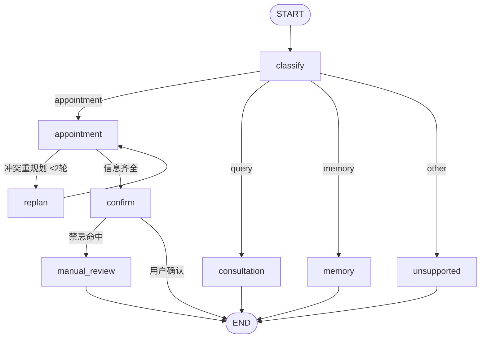

# 智能健康理疗预约与服务 Agent 平台

面向健康理疗 / 中医馆预约场景的多智能体服务系统，覆盖 **咨询 → 预约 → 禁忌筛查 → 疗程回访** 的完整服务链路。系统由四个智能体协作完成业务：意图分类（主控）、智能预约、知识咨询、长记忆偏好总结，基于 **LangGraph 图状态机**统一编排，并通过 SQLite Checkpointer 实现会话持久化与多会话隔离。

## 智能体架构

| 智能体 | 职责 | 核心能力 |
|---|---|---|
| **意图分类**（主控） | 识别用户意图并路由到对应智能体 | LLM 四分类（预约/咨询/记忆/其它）+ 状态机 + 路由 |
| **智能预约** | 预约流程编排 | 结构化槽位抽取（Pydantic + 修复重试）、理疗师匹配、档期冲突自愈、确认与禁忌筛查、天气提醒 |
| **知识咨询** | 理疗知识问答 | Milvus 双向量混合检索（BM25 稀疏 + DashScope 稠密 + gte-rerank-v2 精排），流式生成带引用回答 |
| **长记忆偏好总结** | 用户画像与记忆 | 行为记录、离线偏好整合（置信度更新）、历史偏好查询回答、疗程回访提醒 |

## 编排设计（LangGraph）



- **图状态机**：`classify` 节点输出意图分类，条件边路由到业务节点；`appointment` 节点内部包含信息收集回环、确认节点（含禁忌筛查）与档期冲突重规划回环。
- **有界自愈循环**：档期冲突时由 replan 节点让 LLM 重规划（换时间/换理疗师）后重试，最多 2 轮；连续相同 `hash(工具+参数)` 触发熔断并输出降级话术。
- **持久化**：`SqliteSaver` Checkpointer，`thread_id = session_id`，服务重启后会话可恢复、断点可续跑。
- **流式透出**：节点通过 stream writer 实时透出 token，保持逐 token 流式体验。

## 核心能力

- **多会话隔离与持久化**：会话状态按 `session_id` 键控（`SessionRegistry`），聊天历史内存 + SQLite 双写，重启可恢复。
- **结构化输出**：预约信息抽取走 `with_structured_output`（Pydantic 模型）；解析失败自动携带错误信息修复重试 1 次，再失败降级并计数。
- **档期冲突自愈**：指定理疗师不可用时，先基于专长 Embedding 相似度推荐替代候选人，或由 LLM 重规划时间，循环有界、熔断兜底。
- **确认与禁忌筛查**：落库前输出预约摘要等用户确认；禁忌症（高血压/孕期/皮肤破损）命中即转人工评估、不自动落库。
- **理疗师匹配**：性别、手法偏好过滤 + 专长相似度排序 + 档期可用性检查。
- **RAG 知识咨询**：Milvus 双向量混合检索（BM25 稀疏 Function + DashScope text-embedding-v3 稠密 Function）→ RRF 融合 → gte-rerank-v2 语义精排 → DeepSeek 生成（回答带引用页码/章节）；PDF 上传经 MinerU 解析 + 结构感知/递归字符/滑动窗口切分自动入库；知识库增删改查实时生效；回答真流式输出。
- **长记忆偏好画像**：行为记录（预约/咨询）+ 后台整合任务（水位游标增量回放 → 结构化抽取 → 向量去重 → "频次×新近度"置信度更新，幂等可重试）；用户可查询自己的历史偏好（"我上次约的哪位理疗师"）。
- **疗程回访**：结合偏好画像与理疗师空闲档期生成个性化回访消息（定时调度）。
- **天气提醒**：预约成功后结合 Open-Meteo 实时天气（免费地理编码 + 天气 API，无需密钥）生成理疗后保暖提醒；天气服务不可用时优雅降级。
- **领域词表配置**：`config/domain_terms.py` 集中管理领域词表（禁忌症、业务称谓、服务项目目录），提示词与消息文案统一引用，避免各处硬编码措辞不一致。
- **模型混合部署**：对话与抽取用云端 DeepSeek（deepseek-chat）；全链路向量化统一走 DashScope text-embedding-v3（知识 RAG 由 Milvus 服务端 Function 调用，记忆/技师由应用侧直连），精排用 gte-rerank-v2。
- **评测流水线**：`evals/` 黄金评测集（意图分类 50 / 槽位抽取 30 / 咨询问答 40 / 端到端 10，含时间归一化、禁忌命中、档期冲突用例），一键产出报告，失败样本回灌回归。
- **可观测性**：轻量 TraceContext 记录各阶段耗时与 Token 到 JSON Lines，`/metrics` 端点聚合。

## 五层架构

```text
Web & Application Layer
    ↓  app.py, application/, web/：应用组装根、页面、路由入口、系统启动
API Layer
    ↓  api/：外部接口、请求编排、响应封装
Agents Layer
    ↓  agents/：四个智能体、LangGraph 编排、会话上下文
Services Layer
    ↓  services/：业务逻辑、推荐与记忆整合、向量处理、会话持久化
DB Layer
    ↓  db/：数据模型、数据库连接、Repository
```

下层不反向调用上层；Agents 层只经 Services 层访问数据。

## 技术栈

- **编排框架**：LangGraph（图状态机 + SQLite Checkpointer）
- **LLM**：DeepSeek（OpenAI 兼容协议，工厂模式支持多 Provider 切换）
- **Embedding**：全链路统一 DashScope text-embedding-v3（1024 维）——知识 RAG 由 Milvus 服务端调用，记忆/技师由应用侧直连
- **后端框架**：FastAPI、Uvicorn
- **数据库**：SQLite、SQLAlchemy（Repository 模式）
- **向量检索**：Milvus 2.6（BM25 稀疏 + 稠密双向量，RRF 融合 + gte-rerank-v2 精排）
- **文档解析**：MinerU 云 OpenAPI v4（mineru.net，Bearer 鉴权，本地不部署；精准解析模式）
- **天气服务**：Open-Meteo（免费地理编码 + 天气 API，免密钥）
- **测试**：pytest（全离线，FakeLLM/FakeEmbedding，无需 API Key 与网络）

## 快速开始

### 1. 创建虚拟环境（uv）

```bash
uv venv --python 3.11
uv pip install -r requirements.txt
```

### 2. 配置环境变量

```bash
cp .env.example .env
```

在 `.env` 中填写 DeepSeek API Key：

```env
MODEL_PROVIDER=deepseek
LLM_API_KEY=your_deepseek_api_key_here
LLM_BASE_URL=https://api.deepseek.com
LLM_MODEL=deepseek-chat

# Milvus 向量库（BM25 稀疏 + DashScope 稠密 + 精排，由 Milvus 服务端调用云 API）
MILVUS_URI=http://localhost:19530
# DashScope 凭证：DASHSCOPE_API_KEY=text-embedding-v3 向量化；DASHSCOPE_RERANK_API_KEY=gte-rerank-v2 精排
# （Milvus 容器侧需配置同名环境变量，勿加 MILVUSAI 前缀；应用侧兜底直连也读这两个）
DASHSCOPE_API_KEY=your_dashscope_embed_api_key_here
DASHSCOPE_RERANK_API_KEY=your_dashscope_rerank_api_key_here
RERANK_BACKEND=milvus
# MinerU 云文档解析服务（官方 OpenAPI v4，本地不部署）
MINERU_BASE_URL=https://mineru.net/api/v4
MINERU_TOKEN=your_mineru_api_token_here
# 解析模式：vlm=精准解析（默认）/ pipeline=普通
MINERU_MODEL_VERSION=vlm

DATABASE_URL=sqlite:///./data/smart_appointment.db
```

> 知识 RAG 的编码与精排由 Milvus 服务端 Function 出网调用 DashScope 云 API；
> 凭证为 Milvus 容器侧同名环境变量 `DASHSCOPE_API_KEY`（嵌入）与
> `DASHSCOPE_RERANK_API_KEY`（精排），**勿加 MILVUSAI 前缀**。
> 应用侧 `.env` 中同样的两个键用于：记忆/技师向量化、精排兜底直连与检索兜底编码。

### 3. 启动 Milvus（知识 RAG 向量库）

```bash
docker compose up -d etcd minio milvus   # Milvus 2.6 standalone（首次自动建集合与索引）
```

### 4. 启动服务

```bash
python -m uvicorn app:app --host 127.0.0.1 --port 8000 --reload
```

访问：Web 页面 http://127.0.0.1:8000 、API 文档 http://127.0.0.1:8000/docs
（知识库管理页含 PDF 上传入库：MinerU 解析 → 结构感知切分 → Milvus 双向量入库）

## 测试与评测

```bash
# 离线测试（无需 API Key、不联网）
python -m pytest tests/

# 评测流水线（需要 DeepSeek Key、DashScope 凭证与 Milvus 服务；自动使用独立评测库，不碰生产数据）
python -m evals.run --subset intent,slots,qa,e2e
python -m evals.run --subset qa --limit 5     # 抽样小跑
EVAL_KEEP_DB=1 python -m evals.run            # 保留评测库（默认每次重建）
```

评测报告输出至 `evals/report.md`，包含意图路由准确率、槽位 Exact Match、咨询回答正确率、端到端成功率与 P95 延迟。

### 最新评测指标（2026-10-08，evals/report.md）

| 子集 | 通过/总数 | 准确率 |
|---|---|---|
| 意图分类 intent | 50/50 | 100.0% |
| 槽位抽取 slots | 30/30 | 100.0% |
| 咨询问答 qa | 40/40 | 100.0% |
| 端到端 e2e | 10/10 | 100.0% |

## 可观测性（F1）

- **Trace**：阶段耗时与 Token 记录到 JSON Lines（`logs/traces.jsonl`）
- **指标**：`GET /metrics` 返回进程内请求计数与阶段耗时统计

## Docker 部署（F2）

```bash
docker compose up --build   # 含 Milvus（BM25+DashScope 双向量）；LLM 走 DeepSeek；向量化统一走 DashScope 云 API
```

## 项目结构

```text
smart-appointment-ai-agent-master/
├── agents/                         # 智能体层
│   ├── core/                       # 会话上下文与多会话隔离（SessionContext/SessionRegistry）
│   ├── graph/                      # LangGraph 编排（状态/节点/构建器）
│   ├── task_classification/        # 意图分类、状态机、路由、无关请求处理
│   ├── task_classification_agent.py
│   ├── appointment/                # 结构化抽取、理疗师匹配、消息构建、天气工具
│   ├── appointment_agent.py
│   ├── consultant/                 # 知识检索、咨询分类、提示词、流式生成
│   ├── consultant_agent.py
│   ├── user_behavior/              # 行为记录、偏好管理、模式分析
│   └── user_behavior_agent.py
├── application/                    # 应用组装根（Agent 单例、图生命周期、会话恢复、流式管线）
├── api/                            # API 编排层（含流式聊天入口）
├── services/                       # 业务逻辑层（知识库/向量库/ETL/切分/技师/用户行为/会话/记忆整合）
├── db/                             # 数据持久化层（模型/Repository/路由）
├── config/                         # 配置（模型工厂/向量检索/领域词表/常量/时间）
├── web/                            # Web 页面层
├── evals/                          # 评测流水线与黄金评测集
├── docs/                           # 架构图（LangGraph Mermaid）
├── tests/                          # 离线测试
├── app.py                          # 应用入口
└── requirements.txt                # 依赖（唯一依赖文件，含测试）
```

## 后续规划

- 店员后台的排班/运营智能体（第二类用户角色：排班、改约审批、营业时间调整）
- 支付环节接入（当前预留扩展位）
- 云端部署（Docker 镜像与编排）

---

本项目聚焦多智能体编排、会话可靠性、记忆与评测闭环的工程落地，为健康理疗门店提供从咨询到预约回访的一体化智能服务。
